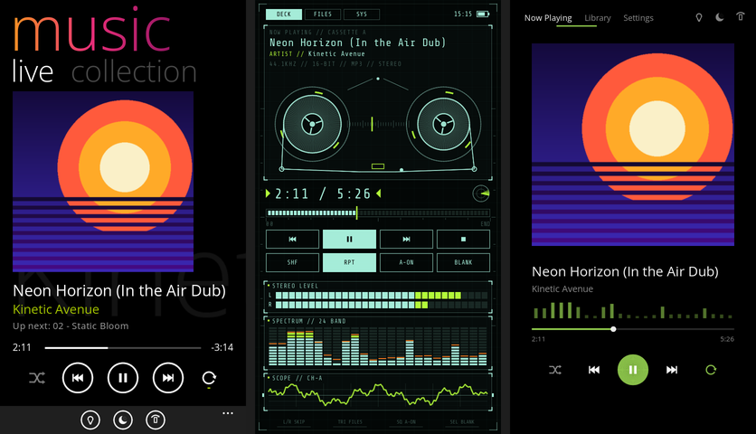
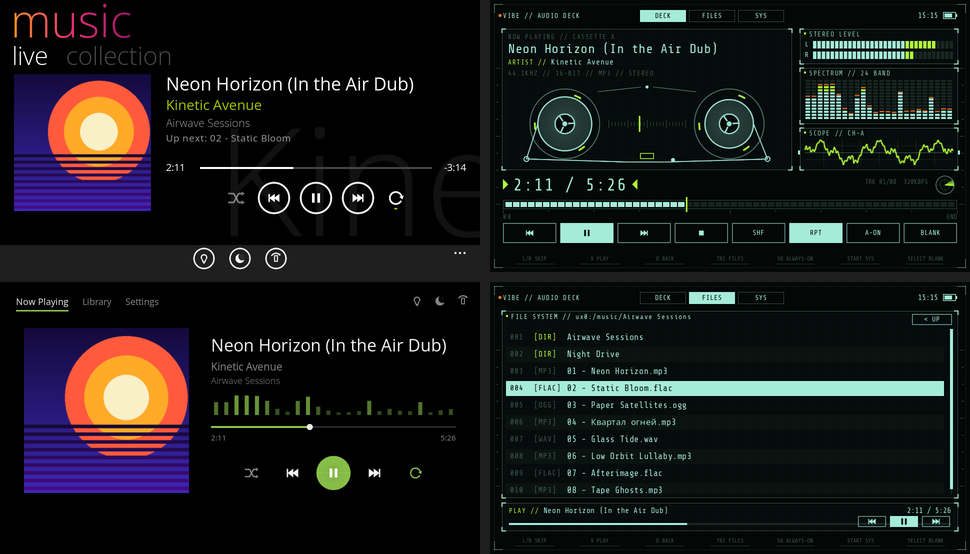

# Vibe — music player for PS Vita

A lightweight native homebrew music player for the PlayStation Vita (tuned for the
PCH-1000 OLED), with three animated skins, portrait and landscape layouts,
background playback and an aggressive battery policy.




*(Renders from the desktop preview tool — same drawing code as the Vita build.)*

## Features

- **Formats:** MP3 (mpg123), OGG Vorbis, FLAC (up to 24-bit / 192 kHz — hi-res is
  decimated to ≤48 kHz), WAV (8/16/24/32-bit PCM, 32-bit float). Tags (ID3v1/v2,
  Vorbis comments, RIFF INFO) incl. Cyrillic; embedded cover art (ID3 APIC, FLAC
  PICTURE, OGG METADATA_BLOCK_PICTURE) or `cover.jpg` / `folder.jpg` in the folder.
- **File browser** over `ux0:` and `uma0:` (plus `imc0:` / `xmc0:` / `ur0:` when present),
  natural sort (track 2 before track 10). Selecting a file queues its folder.
- **Controls:** play, pause, stop, next, previous, seek/scrub, shuffle,
  repeat off / track / all.
- **Background audio:** keeps playing when you press PS (LiveArea) or the power
  button. L/R still skip tracks while the screen is off.
- **Screen off timer:** 5 / 10 / 15 s of inactivity (or never) while playing; any
  button or a touch wakes the display.
- **Always On:** on-screen bulb button or □; holds the OLED awake. Optional
  burn-in protection slowly shifts the whole UI by a few pixels.
- **Orientation:** landscape, portrait (console turned left, buttons up) or portrait
  flipped. D-pad and touch are remapped so "up" is always up on screen.
- **Themes:** true-black dark (#000000) and light, 6 accent colours.
- **Skins:**
  - **Windows Phone Metro** — panorama "music" hub with parallax gradient header,
    pivots, circle buttons, app bar, Zune-style giant drifting artist name,
    turnstile list entry, continuum title slides, WP toasts.
  - **Retro-Futurism** — thin-line HUD: spinning tape reels whose packs follow the
    playback position, oscilloscope, 24-band spectrum with peak hold, stereo level
    meters, radar sweep, segmented seek bar, scan-line page wipe.
  - **Minimal** — clean default layout with mini spectrum.

## Buttons

| Button | Action |
|---|---|
| L / R | previous / next track (works with the screen off too) |
| ✕ (enter) | play/pause · open folder or play file · change setting |
| ○ (back) | up a folder / back |
| △ | switch Now playing ↔ Library |
| □ | Always On toggle |
| START | Settings |
| SELECT | screen off now |
| D-pad (Now playing) | ←/→ seek 10 s · ↑ repeat mode · ↓ shuffle |
| D-pad (lists) | move · ←/→ page |

Touch: tap anything, drag the seek bar, flick lists, swipe left/right to change page.
Enter/back follow the console's ✕/○ setting.

## Install

Copy `vibe.vpk` to the Vita and install it with VitaShell (HENkaku/Enso).
Put music anywhere on `ux0:` or `uma0:` — `ux0:music` opens first.
Settings live in `ux0:data/Vibe/config.txt`.

## Battery & performance

- Decode thread feeds a ~1.3 s ring buffer; a separate output thread drains it to a
  BGM audio port, so SD2Vita read stalls don't reach the speaker.
- Clocks: 333 MHz while animating/interacting, 222 MHz when the UI is static,
  **166 MHz CPU / 41 MHz GPU with the screen off or in the background** (no rendering at all).
- 30 fps when nothing is moving (60 fps during touch, scrolling and transitions;
  optional permanent 60 fps in settings).
- Portrait rotation and burn-in shift are folded into the GPU projection matrix,
  so they cost nothing.
- VPK ≈ 1.3 MB; fonts are subset (Latin + Cyrillic), no bitmap assets besides LiveArea.

## Building

```sh
export VITASDK=/usr/local/vitasdk   # VitaSDK 2026.08 channel
vdpm install libvita2d mpg123 libvorbis libogg flac libpng zlib freetype libjpeg-turbo
mkdir build && cd build && cmake .. && make   # -> vibe.vpk
```

Desktop preview (renders every skin/page/orientation to PNG, needs cairo + freetype):

```sh
make -C tools/preview && tools/preview/vibe_preview docs/previews
```

## Source layout

| File | Role |
|---|---|
| `src/main_vita.c` | loop, input mapping/rotation, screen-off & clock policy |
| `src/player.c` | decode + output threads, queue, shuffle/repeat, seek |
| `src/dec_*.c` | MP3 / OGG / FLAC / WAV decoders + tag & cover parsing |
| `src/sys_vita.c` | background run, BGM port, power ticks, display, clocks |
| `src/gfx_vita.c` / `gfx_host.c` | vita2d backend (rotation via projection) / Cairo preview backend |
| `src/font.c` | FreeType glyph atlas with Cyrillic fallback |
| `src/app.c`, `ui.c` | pages, touch/buttons, settings, FFT visualiser, icons |
| `src/skin_*.c` | the three skins |

## Credits & licences

- Background-playback recipe (SFO `ATTRIBUTE=0x88008`, BGM port, shell close
  event) follows [ABSvita](https://github.com/DarthTigerson/ABSvita) by DarthTigerson (MIT).
- [libvita2d](https://github.com/xerpi/libvita2d), mpg123 (LGPL-2.1), libvorbis/libogg
  (BSD), libFLAC (BSD), FreeType (FTL), libjpeg-turbo, libpng, zlib.
- Fonts: Open Sans and Share Tech Mono, SIL Open Font License (`assets/fonts/OFL-*.txt`).
- Not affiliated with Microsoft or Sony; the Metro skin is an homage to the WP7/8 design language.
